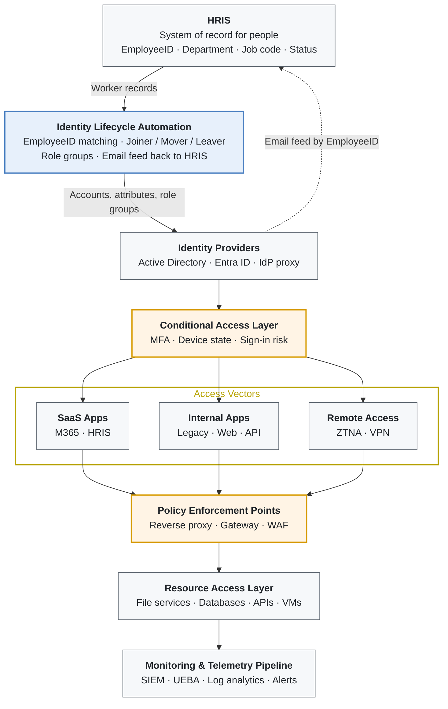

# Identity Lifecycle & Access Automation

Active Directory redesign, EmployeeID-anchored identity matching, group-based RBAC with PIM, and automated joiner / mover / leaver handling, all enforced through Conditional Access in an identity-centric zero-trust model.

[](https://github.com/Moondark87/identity-lifecycle-automation/actions/workflows/tests.yml)

> **Portfolio note:** This repository consolidates identity and access work I did across several organizations. The documentation describes the architecture and operating model. The PowerShell module is a clean-room reimplementation written for this portfolio: no employer code, data or configuration is included, and every name, ID and record in the examples is fictional.

**Author:** Alex Scheaffer

---

## The Problem

Across the environments I worked in, identity had the same failure points:

- **Directory structure mirrored the org chart**, so a transfer meant moving the account and accidentally changing its Group Policy.
- **No reliable link between HR and IT identities.** People were matched across systems by name or email, which produced duplicates and access attached to the wrong person.
- **Access was granted person by person.** Movers kept old access, and offboarding meant hunting for everything someone had.
- **Offboarding was manual**, so it was slow and inconsistent, and onboarding needed a ticket per system.
- **HR systems held typed copies of email addresses** that drifted from the directory.

## The Solution

| Pillar | What it does | Details |
|---|---|---|
| **Flat directory** | OUs by object type and admin tier; department and location become attributes; GPOs target groups | [directory-design.md](docs/directory-design.md) |
| **One identity anchor** | HRIS EmployeeID is the only automatic join key across AD, Entra ID and SaaS | [identity-matching.md](docs/identity-matching.md) |
| **Group-based RBAC** | Users → role groups → resource groups → permissions, licenses, GPOs and CA | [rbac-and-pim.md](docs/rbac-and-pim.md) |
| **Just-in-time privilege** | Separate admin accounts, PIM-eligible, activated with phishing-resistant MFA | [rbac-and-pim.md](docs/rbac-and-pim.md#privileged-identity-management) |
| **Lifecycle automation** | HRIS-driven joiner / mover / leaver plan, applied safely, with an email feed back to HRIS | [lifecycle-automation.md](docs/lifecycle-automation.md) |
| **Conditional Access** | Policies assigned to role groups, so access follows HR changes automatically | [conditional-access.md](docs/conditional-access.md) |

## Architecture

<!-- diagram: diagrams/zero-trust-architecture.mmd -->


Layer-by-layer walkthrough: [docs/architecture.md](docs/architecture.md)

## See It Run

The planner runs offline against the sample HRIS export and directory snapshot. No directory access is needed:

```powershell
.\scripts\Invoke-IdentitySync.ps1 -HrisCsvPath .\examples\hris-export.sample.csv `
    -DirectorySnapshotPath .\examples\directory-snapshot.sample.json -AsOf 2026-10-16
```

```
Action   EmployeeID SamAccountName DisplayName    Reason
------   ---------- -------------- -----------    ------
Joiner   100104     tom.herrera    Tom Herrera    Pre-hire; created disabled, enabled on 2026-10-19.
Joiner   100105     aisha.bello    Aisha Bello    New hire; start date reached.
Joiner   100114     marcus.lee2    Marcus Lee     New hire; start date reached.
Activate 100115     nina.patel     Nina Patel     Start date reached; enable pre-hire account.
Mover    100103     priya.raman    Priya Raman    Department change: Sales -> Finance.
Update   100110     robert.chen    Robert Chen    Attribute change: Title.
Leaver   100106     kevin.oconnor  Kevin O'Connor Terminated effective 2026-10-15.
Review                             Chris Dale     HRIS record has no EmployeeID. Fix in HRIS; it cannot be matched.
Review              kiosk.lobby    Kiosk Lobby    Enabled account has no EmployeeID. Link to an HRIS record, ...
Review   100090     owen.grant     Owen Grant     Disabled 2026-08-03; 30-day retention has ended. Eligible for deletion (manual).
Review   100099     jordan.miles   Jordan Miles   Orphaned account: EmployeeID not found in HRIS. ...
Review   100108     james.park     James Park     HRIS shows active but the account is disabled (rehire or HRIS error). ...
Review   100109                    Elena Novak    Possible existing account without EmployeeID: elena.novak. ...
```

The full plan, with attribute and group changes per person, is in [`examples/identity-plan.sample.json`](examples/identity-plan.sample.json). Against a real directory, add `-Apply -WhatIf` to preview the changes, then `-Apply` to make them.

### Safety model

- **Plan first.** Planning is read-only; applying is a separate, explicit step, and every change supports `-WhatIf`.
- **Ambiguity goes to people.** Missing or duplicate IDs, possible name matches, orphans and rehires become Review items, which are never applied.
- **No automated privilege.** The role map can only contain `ROLE-` groups; anything else stops the run.
- **Admins leave with their owner.** A leaver's `adm-` account is offboarded in the same run.
- **Nothing is deleted automatically**, and every action is written to a JSON audit log for the SIEM.

## Repository Structure

```
.
├── src/IdentityLifecycle/    PowerShell module: matching, planning, applying
├── scripts/                  Invoke-IdentitySync.ps1, the scheduled-task entry point
├── config/                   Example settings and role map (real ones stay out of the repo)
├── examples/                 Fictional HRIS export, directory snapshot, generated plan and email feed
├── tests/                    Pester 5 tests (AD cmdlets mocked; no directory needed)
├── docs/                     Architecture, directory design, RBAC/PIM, matching, lifecycle, CA
│   └── decisions/            Architecture Decision Records
└── diagrams/                 Mermaid sources
```

## My Contribution

- Revamped Active Directory and flattened OU structures at several organizations
- Unified employee matching across multiple systems and data points, anchored on EmployeeID
- Architected RBAC and privileged access (PIM) through groups, nested groups and Group Policy
- Tied identity and group membership to Conditional Access policy
- Automated offboarding and simplified onboarding
- Built HRIS workflows that read email addresses from AD, matched by EmployeeID
- Designed the identity-centric zero-trust architecture shown above

## Impact

- Employee access could be tracked, changed, moved, revoked and offboarded from one place, driven by HR data
- Offboarding went from a manual checklist to an automated, audited process
- Onboarding needed far fewer manual steps, with access ready on day one
- One identity per person across HRIS, AD, Entra ID and connected apps
- Role changes updated access automatically instead of accumulating it

## Requirements

- Windows PowerShell 5.1 or PowerShell 7+
- RSAT ActiveDirectory module, only for live runs (planning against a snapshot needs nothing)
- Optional: Microsoft Graph PowerShell (`Microsoft.Graph.Users.Actions`) to revoke Entra sessions for leavers
- Tests: Pester 5.5+

## License

[MIT](LICENSE)
