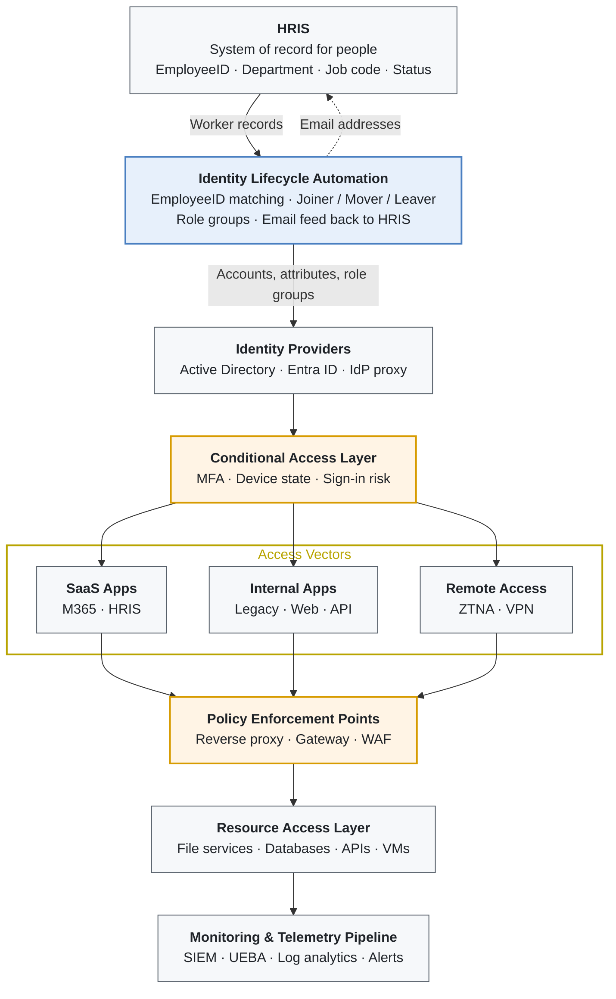

# Identity-Centric Zero-Trust Architecture

Author: Alex Scheaffer

Every access decision starts from a verified identity, and every identity starts from an HR record. The architecture has two halves:

- **Lifecycle (who exists and what they hold):** HRIS → EmployeeID matching → Active Directory and Entra ID accounts, attributes and role groups.
- **Access path (whether a request is allowed right now):** identity provider → Conditional Access → access vector → policy enforcement point → resource, with telemetry at every hop.

The lifecycle half keeps identities and groups correct. The access path evaluates those identities and groups on every request.

<!-- diagram: diagrams/zero-trust-architecture.mmd -->

---

## Layers

### 1. HRIS: system of record for people
HRIS owns the facts about a person: EmployeeID, legal and preferred name, department, job code, title, location, manager, worker type and employment status. Nobody types these into AD by hand. See [identity-matching.md](identity-matching.md) for who owns which attribute.

### 2. Identity lifecycle automation
Reads the HRIS export, matches people to accounts **only on EmployeeID**, and plans joiner, mover and leaver changes ([lifecycle-automation.md](lifecycle-automation.md)). It manages role-group membership but cannot grant privileged access. It also publishes each person's email address back to HRIS, so HRIS reads email from the directory instead of storing a typed copy.

### 3. Identity providers
- **Active Directory:** authoritative for accounts, a flat OU structure ([directory-design.md](directory-design.md)), and group nesting ([rbac-and-pim.md](rbac-and-pim.md)).
- **Entra ID:** synchronized from AD (Entra Connect), including `employeeId`. Hosts Conditional Access and PIM.
- **IdP proxy:** federates legacy and SaaS applications that can't talk to Entra directly.

### 4. Conditional Access
Every sign-in is evaluated for MFA, device compliance and sign-in risk. Policies are assigned to **role groups**, so a person's policy changes as soon as their HR record does. See [conditional-access.md](conditional-access.md).

### 5. Access vectors
| Vector | Examples | Notes |
|---|---|---|
| SaaS apps | M365, HRIS | SSO through Entra ID; provisioning via SCIM where available |
| Internal apps | Legacy, web, API | Published behind the enforcement layer, never directly exposed |
| Remote access | ZTNA, VPN | Access granted per application through group membership, not per network |

### 6. Policy enforcement points
Reverse proxies, gateways and WAFs sit in front of internal resources and enforce the identity and device decision at the edge of each app, not just at sign-in.

### 7. Resource access
File services, databases, APIs and VMs grant permissions to **resource groups**, never to individual users. Resource groups contain role groups.

### 8. Monitoring & telemetry
Sign-in logs, Conditional Access results, PIM activations, directory changes and the lifecycle automation's own audit log flow to the SIEM. UEBA and alerting watch for risky sign-ins, unusual privilege activation and access by accounts that should no longer exist.

---

## Design principles

| Principle | How it shows up |
|---|---|
| **HR is the source of truth** | Accounts are created, changed and disabled from HRIS data; manual edits are overwritten on the next sync |
| **One identity anchor** | EmployeeID is the only automatic join key between systems |
| **Access through groups only** | Users → role groups → resource groups → permissions; no direct grants |
| **No standing privilege** | Admin rights are PIM-eligible, time-bound and activated with MFA |
| **Verify every request** | Conditional Access and enforcement points evaluate identity, device and risk on each access |
| **Humans decide the ambiguous cases** | Anything automation can't match with certainty becomes a Review item |
| **Everything is logged** | Every lifecycle action and every access decision reaches the SIEM |
