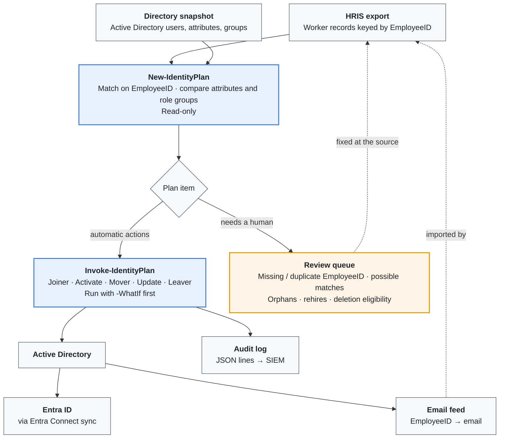

# Joiner / Mover / Leaver Automation

Author: Alex Scheaffer

The [`IdentityLifecycle`](../src/IdentityLifecycle/IdentityLifecycle.psm1) module turns an HRIS export into a reviewable plan, then applies only the parts that are safe to automate.

<!-- diagram: diagrams/lifecycle-flow.mmd -->


## Plan actions

| Action | Trigger | What happens when applied |
|---|---|---|
| **Joiner** | Active/Pending in HRIS, no account, start date within the lead window (default 7 days) | Account created in the Employees or Contractors OU with a generated `first.last` name, UPN/email, HR attributes, manager and role groups. Created **disabled** if the start date is in the future |
| **Activate** | Pre-hire account and start date reached | Account enabled; pre-hire marker cleared |
| **Mover** | Department, job code, location or worker type changed, so role groups differ | Attributes updated; new role groups added, old ones removed |
| **Update** | Title or manager changed; role groups unchanged | Attributes updated |
| **Leaver** | Terminated in HRIS and end date reached | See below |
| **NoChange** | In sync, future hire, scheduled termination, already disabled | Nothing |
| **Review** | Anything ambiguous (see [identity-matching.md](identity-matching.md)), rehire of a disabled account, account past retention | **Never applied.** A person resolves it |

## Offboarding

Applied in this order, with each step written to the audit log:

1. **Record** every group membership (so access can be reviewed or restored).
2. **Disable** the account and **reset** its password to a random value.
3. **Stamp** the description: `Disabled <date> by identity lifecycle automation (EmployeeID <id>). Delete after <date>.`
4. **Remove** all group memberships except the primary group. Group-based licenses, app access, file shares, VPN and Conditional Access assignments go with them.
5. **Hide** from the global address list (hybrid Exchange).
6. **Revoke** Entra ID refresh tokens and sessions (`Revoke-MgUserSignInSession`), so cloud sessions end now instead of at token expiry.
7. **Move** to the `Disabled` OU.

After the retention period (default 30 days) the account shows up as a Review item, "eligible for deletion." **Deletion is always manual.**

## Onboarding

- Accounts are created up to 7 days before the start date, **disabled**, so licenses, mailbox and group-based access are ready on day one.
- The initial password is random and never shown or stored. First sign-in uses a **Temporary Access Pass** or self-service password reset, issued through the normal onboarding process.
- The email address is published back to HRIS the same day, so HR systems, payroll and downstream apps get the real address instead of a guess.

## Safety model

| Guardrail | Where |
|---|---|
| Planning is read-only; applying is a separate, explicit step | `New-IdentityPlan` vs `Invoke-IdentityPlan` / `-Apply` |
| Every change supports `-WhatIf` | `SupportsShouldProcess` on every apply function |
| Review items are never applied | `Invoke-IdentityPlan` skips them |
| Automation can't grant privileged access | `Test-RoleMap` rejects any group without the `ROLE-` prefix |
| Movers never remove manually managed groups | Only `ROLE-` groups are compared |
| Admin, service and break-glass accounts are excluded | `ExcludeAccountPatterns` in settings |
| Disabled former employees are never re-enabled automatically | Rehire → Review |
| One failure doesn't stop the run | Each item runs in its own `try` / `catch`; failures are audited |
| Full audit trail | JSON-lines audit log, forwarded to the SIEM |

## Running it

```powershell
# 1. Offline demo with the sample data (no directory needed)
.\scripts\Invoke-IdentitySync.ps1 -HrisCsvPath .\examples\hris-export.sample.csv `
    -DirectorySnapshotPath .\examples\directory-snapshot.sample.json -AsOf 2026-10-16

# 2. Live plan against AD (read-only)
.\scripts\Invoke-IdentitySync.ps1 -HrisCsvPath \\hris\exports\workers.csv `
    -SettingsPath .\config\settings.json -RoleMapPath .\config\roles.json

# 3. Dry-run the apply step
.\scripts\Invoke-IdentitySync.ps1 -HrisCsvPath \\hris\exports\workers.csv -Apply -WhatIf

# 4. Apply, and publish the email feed for HRIS
.\scripts\Invoke-IdentitySync.ps1 -HrisCsvPath \\hris\exports\workers.csv -Apply `
    -EmailFeedPath \\hris\imports\email-feed.csv
```

In production this runs as a scheduled task under a gMSA that is delegated only the rights it needs on the `Users` and `Groups\Roles` OUs. It runs after the nightly HRIS export, plus on demand for same-day terminations. Real settings and role maps live outside the repo, which keeps only the `*.example.json` versions.
