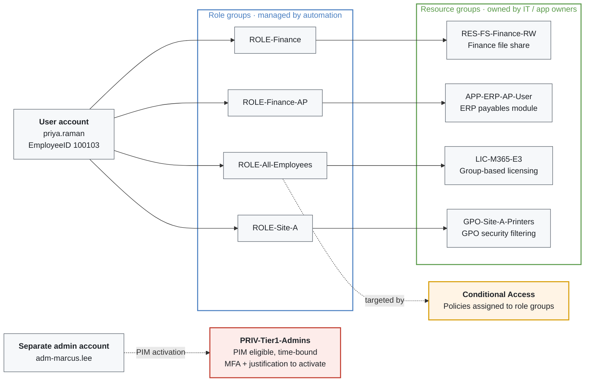

# Role-Based Access Control & Privileged Access

Author: Alex Scheaffer

Access is granted to **groups**, groups are nested in a fixed pattern, and privileged access is never standing.

<!-- diagram: diagrams/rbac-model.mmd -->

## Group layers

| Layer | Prefix | Members | Managed by | Grants |
|---|---|---|---|---|
| **Role** | `ROLE-` | User accounts | Lifecycle automation, from HRIS data | Nothing directly; nested into resource groups |
| **Resource** | `RES-`, `APP-` | Role groups | Resource / app owners | File share, app, database or API permissions |
| **Licensing** | `LIC-` | Role groups | IT | M365 and SaaS licenses (group-based licensing) |
| **Policy** | `GPO-` | Role groups | IT | GPO security filtering |
| **Privileged** | `PRIV-` | Admin accounts, PIM-eligible only | Identity team + PIM | Admin roles, time-bound |

This is the classic AGDLP pattern (Accounts → Global groups → Domain Local groups → Permissions), extended to licensing, Group Policy and Conditional Access.

## How roles are derived

Role groups come from four HRIS fields, defined in [`config/roles.example.json`](../config/roles.example.json):

| HRIS field | Example | Role group |
|---|---|---|
| Worker type | Employee | `ROLE-All-Employees` |
| Department | Finance | `ROLE-Finance` |
| Job code | FIN-AP | `ROLE-Finance-AP` |
| Location | SITE-A | `ROLE-Site-A` |

When HRIS changes any of these, the next sync adds the new role groups and removes the old ones. Everything nested underneath (shares, apps, licenses, GPOs, Conditional Access) follows automatically. Nobody has to remember to remove last department's access.

## Guardrails

- **Users are never placed directly in resource groups.** If a person needs something their role doesn't give, the fix is a new or adjusted role, not a one-off grant.
- **Automation touches only `ROLE-` groups.** `Test-RoleMap` refuses to run if the role map contains any other prefix, so automation cannot grant `PRIV-` access, even by mistake.
- **Other memberships are left alone by movers.** Manually managed groups (e.g. `VPN-Users`) are reported but not removed when someone changes role; leavers lose everything except their primary group.
- **Resource groups have named owners**, who review membership (which is role groups, a short list) instead of reviewing individual users.

## Privileged Identity Management

| Control | Implementation |
|---|---|
| Separate admin identities | `adm-` accounts in tiered OUs; daily-use accounts hold no admin rights |
| No standing access | Admin accounts are **eligible** for `PRIV-` groups through Entra PIM for Groups, not permanent members |
| Just-in-time activation | Time-bound (e.g. 1–8 hours), with justification and ticket reference |
| Strong authentication to activate | Conditional Access authentication context requires phishing-resistant MFA and a compliant device |
| Approval for the highest tiers | Tier 0 activation requires a second approver |
| Visibility | Every activation is logged to the SIEM and alerts on activation outside change windows |
| Periodic review | Access reviews of PIM eligibility; unused eligibility is removed |

Admin accounts carry the owner's EmployeeID, so when that person leaves the lifecycle process finds and disables the admin account too, even though it is excluded from normal role management.
